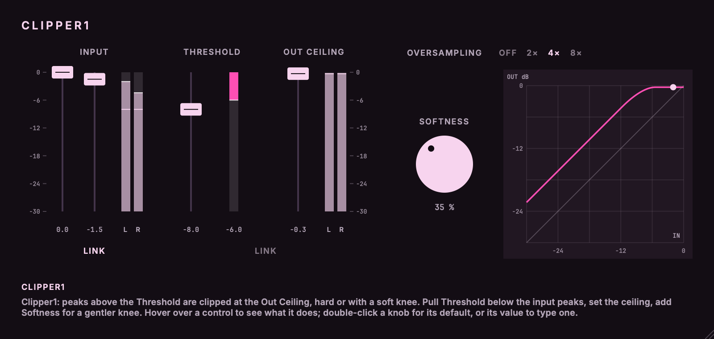

# Clipper1

A stereo clipper with a soft knee and optional oversampling.<br>
Part of the codycodie plug-in collection.

Clipper1 raises the level and cuts the peaks off at a ceiling. Everything below the Threshold gets a
constant gain of Ceiling - Threshold; peaks above it are clipped at the Out Ceiling, either hard or
through a smooth knee whose width is the Softness knob. Oversampling runs the clip at 2, 4 or 8 times the
sample rate so the harmonics a clip makes above Nyquist are filtered out instead of folding back as
aliasing. The curve is a quadratic soft knee and the oversampling uses JUCE's half-band FIR
filters; the knee mapping, latency, overshoot and aliasing numbers are designed and measured for
this plug-in. The knee follows the compressor soft knee of Giannoulis, Massberg and Reiss (2012),
applied to level. [docs/dsp.md](docs/dsp.md) has every constant and measurement.



Faders and meters share one dB scale. The line across the input meters is the Threshold and the
line across the output meters is the Out Ceiling. The meter between the Threshold and Out Ceiling
is a measured clip meter: the peak reduction the curve is applying right now. The square display
on the right is the real input-to-output curve for the current Threshold, Out Ceiling and Softness
(drawn by the same function the audio runs), with a dot at the recent input peak. Hovering over a control explains it in
the strip at the bottom. The window scales from 0.75 to 2 times by dragging its corner.

Clipper1 is an independent product identity. Its bundle identifier is `com.c0dypeng.clipper1`, its
manufacturer code is `Cdpg` and its plug-in code is `Clp1`. It builds as AU and VST3. This
repository is licensed under GPL-3.0 (see [LICENSE](LICENSE)).

## Downloads

Get the latest packages from the [Clipper1 releases page](https://github.com/chijenpeng/clipper1/releases/latest). The macOS release contains Universal AU and VST3 bundles for Apple Silicon and Intel; the bundles are ad-hoc signed and not notarized. The Windows release contains a native x64 VST3, unsigned. Each ZIP includes `INSTALL.txt`, `THIRD_PARTY_NOTICES.md`, `LICENSE`, the dependency licences and build provenance, with a `.sha256` companion file.

## Controls

| Control | Range | Default | What it does |
|---|---|---|---|
| Input L / Input R (`input_l`, `input_r`) | -30..0 dB | 0 | Input level per channel, before the clip. Link Inputs moves them together (a UI convenience; the two values are what is stored). |
| Threshold (`threshold`) | -30..0 dB | 0 | Peaks above this are clipped. Everything below gets a constant gain of Ceiling - Threshold, so lowering the threshold raises the level and clips more. |
| Out Ceiling (`ceiling`) | -30..0 dB | 0 | The highest level that leaves the plug-in. |
| Link (`link`) | on/off | off | Moves Threshold and Out Ceiling together by the same number of dB. Turning it on never changes the sound. |
| Link Inputs (`input_link`) | on/off | on | UI link for the two input faders. |
| Softness (`softness`) | 0..100 % | 0 | Knee width. 0 % is a hard clip. Higher values start bending below the Threshold and reach the ceiling later. |
| Oversampling (`oversampling`) | Off / 2x / 4x / 8x | 4x | Clips at 2, 4 or 8 times the sample rate; adds latency, reported to the host. |

Defaults: no gain, ceiling at 0 dB, a hard clip, 4x. 4x is the default because a hard clip at the
plug-in's own rate aliases audibly on bright material, 4x removes a good part of it for little CPU, and 8x adds
only a few dB more (the final filter's transition band is the same at every factor).

## How it works

- **Curve.** With u the level relative to the Threshold and w = Softness / 100, the output relative
  to the Ceiling is u for |u| up to 1 - w, exactly 1 from |u| = 1 + w, and a quadratic knee between
  them (slope falling from 1 to 0). It is continuous, smooth for w > 0, monotonic and never above the
  ceiling; at 0 % it is the exact hard clip. The Threshold is the knee's centre: at 50 % the knee starts
  6 dB below the Threshold and the ceiling is reached at 3.5 dB above it. Softness 100 % bends from zero
  level.
- **Stereo.** Dual mono: each channel is clipped on its own, with its own Input fader. A sample-wise curve is the
  clipper; linking the channels would change what the curve does.
- **Smoothing.** Gains, Threshold, Ceiling and Softness move with a 10 ms one-pole smoother, so
  there are no clicks. After lowering the Ceiling the output follows the smoothed ceiling for about 50 ms.
- **Oversampling and latency.** Linear-phase half-band FIR filters (JUCE `dsp::Oversampling`,
  maximum quality, integer latency): latency is 0 (Off), 49 (2x), 61 (4x) or 65 (8x) samples at every
  sample rate, reported to the host and updated when the factor changes. Changing the factor fades the sound out
  and in (about 10 ms) instead of clicking.
- **The ceiling with oversampling on.** The downsampling filter overshoots flat-topped signals, so a
  clipped signal can come out above the ceiling: up to about 1.3 dB (2x), 2.6 dB (4x) or 1.6 dB (8x) on a
  hard-clipped full-scale square, much less on programme. To keep the Out Ceiling exact, a final
  clip at the plug-in's own sample rate follows the downsampler. It only acts on those overshoot
  peaks, and being a hard clip it re-introduces a very small amount of aliasing there. With oversampling
  Off the ceiling is exact by construction.

## Limits

- The Out Ceiling is exact at the plug-in's own sample rate: a final hard clip follows the
  downsampler, so no sample leaves above the ceiling in any oversampling mode. That final clip only
  acts on the filter's overshoot peaks and can fold a very small amount of aliasing back.
- Aliasing is reduced, not removed: harmonics that land in the final filter's transition band (about
  21.6 to 26.4 kHz at 48 kHz) fold back partially at every factor (measured: -20.6 dB Off, -30.0 dB at 4x,
  -31.2 dB at 8x of the energy outside the true harmonics, on a near-square tone).
- True-peak (between-sample) overs are not controlled: the ceiling is a sample-value ceiling at the
  plug-in's own rate, and the reconstructed waveform can exceed it.
- Latency depends on Oversampling and is reported to the host: 0 samples (Off), 49 (2x), 61 (4x), 65 (8x),
  at every sample rate. A host that does not re-read it live will catch up on its next transport start.
- Parameter changes are smoothed (10 ms): after lowering the Ceiling the output follows the smoothed
  value for about 50 ms, so it can sit above the new ceiling during that time.
- Changing Oversampling fades the sound out and in (about 10 ms) instead of clicking.
- The editor's clip meter is the curve's reduction; it does not include the final clip's trim.

## Build

CMake 3.22 or later and a C++17 compiler. For AU and VST3 builds use macOS 11 or later; the Windows
VST3 release uses native x64 MSVC from Visual Studio 2022. JUCE 8.0.9: a checkout or symlink at
`third_party/JUCE` is used when present, otherwise CMake fetches the tagged release.

```sh
cmake -S . -B build -G Ninja -DCMAKE_BUILD_TYPE=Release
cmake --build build -j4
ctest --test-dir build --output-on-failure
```

For a universal macOS build add `-DCMAKE_OSX_ARCHITECTURES="arm64;x86_64"`. Plug-in copying is
disabled by default (`-DCOPY_PLUGIN_AFTER_BUILD=ON` copies the AU and VST3 bundles into the user's
Audio Plug-Ins folders). Build products are under `build/Clipper1_artefacts/Release`.

## Validation and snapshots

`clipper1_test` (CTest `clipper1_test`) checks the curve (unity below the knee, exact hard clip, bounded,
odd, monotonic, continuous, smooth), the gain rule, dual mono, non-finite input, the ceiling at every
supported rate with oversampling Off and with the final clip on, aliasing, latency (reported equals the
oversampler's and equals the measured impulse delay, also on the fly), smoothing (largest sample step against a
bound derived from the smoothing coefficient, including factor changes), allocation-free processing and the
Link coupling. It prints PASS or FAIL per check and exits non-zero on any failure.

```sh
./build/clipper1_test             # all checks
./build/clipper1_test ceiling     # one group: curve, gain, ceiling, aliasing, latency, smoothing, realtime, link
cmake --build build --target clipper1_snapshot
./build/clipper1_snapshot_artefacts/Release/clipper1_snapshot docs/editor.png   # optional: editorScale pixelScale
tools/package_macos.sh            # macOS package from a clean commit, after a build-release build
```

The Windows package is built and tested natively by the manual `windows-release.yml` workflow.
